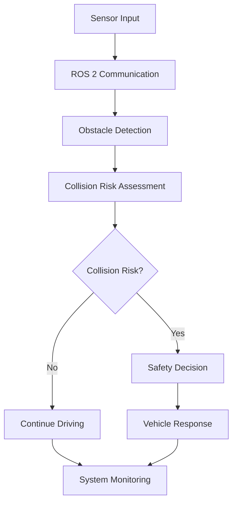

# 🚗 Real-Time Collision Avoidance for Autonomous Driving

### Testing Real-Time Robustness of ROS 2 in Autonomous Driving

<p align="center">
  
  
  
  
  
</p>

---

## 📌 Overview

Autonomous vehicles operate in dynamic environments where safe and reliable decision-making is essential. However, real-world operating conditions such as sensor noise, communication delays, and computational limitations can affect the performance of autonomous driving systems.

This project focuses on developing and evaluating a **real-time collision avoidance system using ROS 2**, supported by MATLAB and Simulink for modeling, simulation, and performance analysis.

The main objective is to investigate the robustness of the system under different operating conditions and evaluate its ability to generate safe vehicle responses.

> **Project Focus:** Real-time collision avoidance, ROS 2 robustness, and autonomous vehicle safety.

## 🎯 Objectives

- Develop a real-time collision avoidance system using ROS 2.
- Design a system architecture for obstacle detection and risk assessment.
- Integrate MATLAB and Simulink for modeling and system evaluation.
- Investigate the effects of sensor disturbances and communication latency.
- Evaluate system response time, reliability, and collision avoidance performance.

## 🧠 System Concept

The proposed system follows a modular processing pipeline:



*The diagram represents the proposed system concept. The final architecture will be updated according to the implemented system.*

## 🛠️ Technologies

| Technology | Purpose |
|---|---|
| ROS 2 | Robot communication and system integration |
| MATLAB | Data analysis and computational evaluation |
| Simulink | System modeling and simulation |
| Python / C++ | Application and ROS 2 development |
| Git & GitHub | Version control and collaboration |

## 📂 Repository Structure

```text
ROS2-Realtime-Collision-Avoidance/
│
├── ros2_ws/          # ROS 2 workspace and packages
├── matlab/           # MATLAB scripts and analysis
├── simulink/         # Simulink models and controllers
├── simulation/       # Simulation environments and scenarios
├── data/             # Experimental and test datasets
├── tests/            # Unit, integration, and robustness tests
├── results/          # Experimental results and evaluation
├── docs/             # Technical documentation
└── video/            # Demonstration and presentation videos
```

## 🚀 Getting Started

### Prerequisites

The following tools are expected to be used during development:

- Ubuntu / WSL2 environment for ROS 2.
- A compatible ROS 2 distribution.
- MATLAB.
- Simulink.
- Git.

> Exact software versions and installation instructions will be documented after the development environment is finalized.

### Installation

Clone the repository:

```bash
git clone https://github.com/JhonsJSSimatupang/ROS2-Realtime-Collision-Avoidance.git
```

Navigate to the project directory:

```bash
cd ROS2-Realtime-Collision-Avoidance
```

ROS 2 workspace setup and build instructions will be added when the ROS 2 package is implemented.

## 🧪 Testing and Evaluation

The project will investigate system performance under different operating conditions.

| Test Scenario | Description | Status |
|---|---|---|
| Normal operation | Baseline system performance | Planned |
| Sensor disturbance | Evaluate the effects of sensor noise | Planned |
| Communication latency | Investigate delayed message delivery | Planned |
| Real-time response | Measure system response time | Planned |
| Collision avoidance | Evaluate safe vehicle response | Planned |

### Evaluation Metrics

Potential evaluation metrics include:

- Collision avoidance success rate.
- System response time.
- Communication latency.
- Message processing frequency.
- System reliability under disturbances.

Final metrics and results will be reported based on completed experiments.

## 📊 Experimental Results

This section will present the actual experimental findings, including:

- Performance comparison between test scenarios.
- Response time and communication latency.
- Collision avoidance performance.
- System robustness analysis.

*Experimental results will be added after validation.*

## 🤖 Generative AI Usage

Generative AI tools may be used to support selected development activities, including:

- Technical research and literature exploration.
- Code development and debugging assistance.
- Documentation and technical writing.
- Analysis of system design alternatives.

All AI-assisted outputs will be reviewed, tested, and validated by the project team. The final implementation and experimental conclusions remain the responsibility of the team.

## 🎥 Demonstration

A demonstration video will be published here once the system implementation and testing are completed.

**Video:** Coming soon.

## 📚 Documentation

| Document | Description |
|---|---|
| [System Architecture](docs/architecture/SYSTEM_ARCHITECTURE.md) | Overall system architecture and communication flow |
| [Testing Methodology](docs/methodology/TESTING_METHODOLOGY.md) | Experimental scenarios and evaluation methods |
| [Software Requirements](docs/requirements/SOFTWARE_REQUIREMENTS.md) | Software and development requirements |
| [References](docs/references/REFERENCES.md) | Research papers and technical resources |
| [Contributing](CONTRIBUTING.md) | Team contribution guidelines |
| [Changelog](CHANGELOG.md) | Project development history |

## 👥 Contributors

| Name | Role | Contribution |
|---|---|---|
| Project Team | Development Team | To be updated |

## 🏆 Competition

This project is developed as part of the **MathWorks Global Student Challenge 2026**, under the Robotics category.

## 📄 License

This project is licensed under the [BSD 2-Clause License](LICENSE).

---

<p align="center">
  <b>Building safer and more reliable autonomous driving systems.</b>
  <br>
  <sub>Developed for MathWorks Global Student Challenge 2026.</sub>
</p>